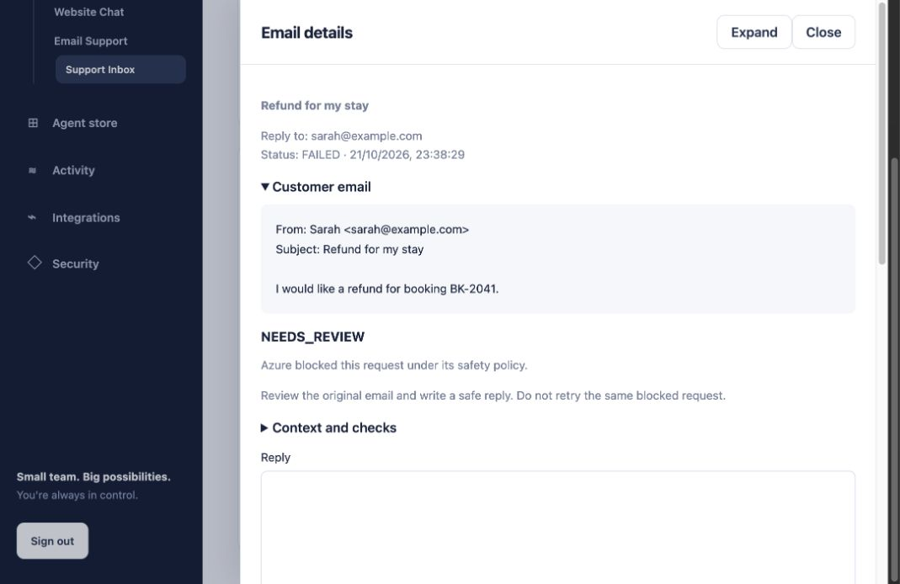

# Testing Email Support

The email agent is ready for a supervised pilot. Keep automatic sending off while we work through the remaining response-quality issues.

## Latest result

The local test suite passed all 104 tests. These use simulated Google and model responses and include intake, booking lookup, draft editing, sending, duplicate protection and recovery after a worker stops.

The live `gpt-4.1-mini` evaluation passed 11 of 12 checks: nine draft checks and two requests blocked by Azure. The missing-price case still failed to request human review. This is a known issue, not a passing result.

P95 was 3,292 ms across these 12 cases. That is a small local sample, not a production latency commitment. Token totals include reservations for calls whose usage was not returned, so they should not be used as a bill.

See the [results](../evals/email-pilot-result.json), [earlier run](../evals/email-pilot-baseline.json) and [test cases](../evals/email-cases.json).

## Finding emails that need attention

Failed processing stays recorded as a failure. The email also appears under **Needs review**, with an explanation and a next step. SoloAI does not invent a draft to fill the gap.

| Status | What it means | Next step |
| --- | --- | --- |
| Queued / Processing | SoloAI has accepted the email. | Wait for the result. |
| Needs review | A draft needs checking, or processing could not finish. | Open the email and follow the explanation. |
| Sending | A send attempt has started. | Do not send another copy. |
| Sent | The mailbox provider accepted the reply. | Acceptance does not confirm recipient delivery. |
| Delivery uncertain | The reply may have been sent, but confirmation is missing. | Check Sent in the mailbox. SoloAI blocks a repeat send. |
| Expired | The retained content has been removed. | Handle the email in the source mailbox. |

If Azure blocks a request, review it yourself rather than repeatedly regenerating it. When you regenerate after changing models or instructions, SoloAI uses the current configuration.



## Running the tests

From the repository root:

```sh
python -m pytest -q
```

Set `TEST_POSTGRES_URL` to a disposable PostgreSQL database to include PostgreSQL tests. The local SQLite run does not prove that production load or database recovery will work.

To run the live evaluation, configure your Azure connection first:

```sh
python -m scripts.email_evaluation --live --output evals/email-pilot-result.json
```

This calls Azure and incurs model usage. It uses a temporary database and fictional messages. It does not connect to Gmail or send replies.

The checks cover known facts, unsupported claims, tool use and requests for human help. Azure safety blocks count only for cases where a block is an acceptable outcome. Ordinary provider errors fail the check. Reports contain results and usage metadata, not messages, replies or credentials.

## Before enabling automatic replies

Review drafts with pilot users and add anonymized examples to the test set. The application requires review for common sensitive requests even when the model says otherwise, but those keyword checks cannot cover every wording or language.

Confirm Gmail consent and token refresh. Run any real send test with an approved test recipient. Exercise PostgreSQL backups, restore and concurrent workers in the deployment environment.

If you use a registered Foundry agent, publish a new version when its instructions change. Direct model mode loads the instructions from this repository. Older queued jobs with a different version require deliberate regeneration.
