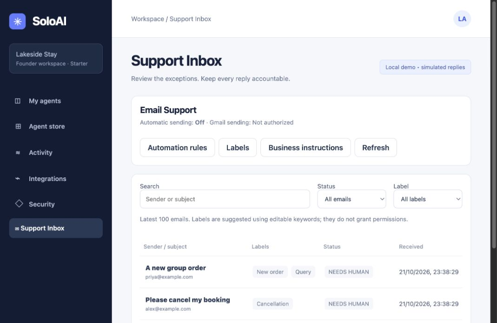
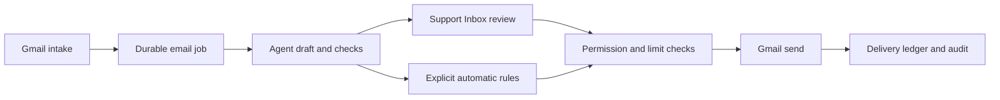

# Support Inbox

Support Inbox puts incoming emails, draft replies and sending controls in one place. Each email is a compact row. Open a row to read the message, edit its reply and see the checks the agent ran. Expand the panel when you need more room.



The screenshot uses fictional messages. No email was sent during validation.



## Review an email

1. Open **Support Inbox** from the sidebar.
2. Search by sender or subject, or filter by status and label.
3. Open an email. Read the customer message and inspect **Context and checks**.
4. Edit the reply. Add any extra context under **Guidance for this email only**.
5. Choose **Save draft** to keep your edits, or **Regenerate draft** to ask the agent for a new reply using your guidance. Regeneration consumes the workspace's token allowance.
6. Choose **Send reply** when the reply is ready. The confirmation names the recipient.

Sending requires a Gmail-origin message with a valid reply destination and separate Gmail send consent. Messages imported before this release, and events forwarded through the generic API, do not have verified Gmail delivery metadata. You can review their drafts, but cannot send them from SoloAI.

The panel shows the ingested message, including any quoted text it contains. It does not fetch the complete Gmail conversation or attachments. Tool names and outcomes are shown; raw tool-result content is not retained.

## Authorize sending

Open **Automation rules → Authorize Gmail sending**. Google requests `gmail.readonly` and `gmail.send`. Choose the same mailbox that is already connected. Reconnecting the same mailbox preserves its intake cursor. Connecting a different mailbox starts a new intake baseline and prevents replies to the old mailbox's tickets.

Reading permission does not grant sending permission. Successful authorization does not enable automatic replies. Reconnecting or disconnecting Gmail pauses automatic sending. Labels are local to SoloAI and never change Gmail labels.

The account owner completes Google's consent screen. If the Google OAuth application is still in testing, add the mailbox as a test user and configure the additional scope in Google Cloud. Existing callback URLs stay unchanged.

## Automatic replies

Automatic sending starts off. To enable it, choose eligible labels and a daily send limit, then save the rules. The daily limit applies to manual and automatic replies, resets at midnight UTC, and conservatively counts delivery attempts.

Only emails received after the rules were saved are considered. Existing review work does not suddenly start sending. The email worker must be running.

The server checks permission again immediately before dispatch. A message stays in review when the agent requests help, the draft was edited or regenerated, the source is automated mail, a booking lookup was used, or the content matches sensitive refund, cancellation, booking, account, payment or order terms. These are conservative English-language checks, not a guarantee that an answer is safe or correct. Use a small daily limit and narrow labels during a pilot. A label by itself never authorizes delivery.

**Pause automatic sending** stops new dispatches. It cannot recall a reply already being dispatched. Disabling the agent or using emergency stop also blocks new sends. An old draft invalidated by emergency stop must be regenerated after enabling the agent.

The model still produces drafts. It has no send tool. SoloAI's delivery code decides whether a draft is eligible to leave the system.

## Labels

Default labels are Refund, New order, Cancellation, Query and Miscellaneous. Create, rename or remove labels from the toolbar. Comma-separated keywords suggest labels for new messages; this release uses simple text matching, not a second AI classification call. Multiple labels are allowed. Correct labels while editing a draft.

Changing label definitions does not relabel old emails. Editing or removing a label pauses automatic sending. Removing one also disables instructions scoped to that label. Emails are never deleted by removing a label.

## Instructions for future emails

Use **Save guidance for future emails** from an email, or **Business instructions** in the toolbar. Review the wording and choose whether it applies to all emails or one label. You can edit, disable or delete it later.

These are saved business instructions, not model retraining. They are supplied to subsequent executions, including regeneration. Existing drafts do not change. The current implementation keeps a revision number and audit events, not a full text history or rollback UI. Instructions cannot grant tools, cross workspace boundaries or override sending checks.

Keep credentials and personal customer details out of reusable rules. Saved business instructions remain until you delete them. Email content, recipient metadata and email-specific guidance follow the configured email retention period.

## Deployment

This feature uses the existing email worker and database. No new Azure service is needed. Production requires PostgreSQL; SQLite remains a local-development option. The default Azure SQL infrastructure profile does not support this email workflow.

Back up the database, stop API and worker processes, and run the additive migration with the deployment's environment:

```bash
python -m scripts.email_admin migrate
```

Migration 003 adds inbox tables. It does not rewrite existing jobs. Start the updated API and worker together after migration. Local development with schema initialization enabled applies it on startup. Do not run an older API/worker while sending is enabled. For rollback, pause sending and stop workers first; keep the additive tables and delivery ledger so sent messages cannot be replayed accidentally.

A new Prometheus counter, `soloai_email_deliveries_total{status="SENT|FAILED|UNKNOWN"}`, records completed delivery attempts. Audit events record the execution and whether the workspace owner or agent initiated sending. This version has one owner per workspace, not a multi-agent staff assignment system.

See [delivery recovery](runbooks/EMAIL-DELIVERY.md) for failed or uncertain sends.
