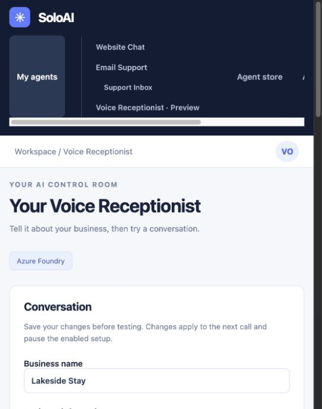
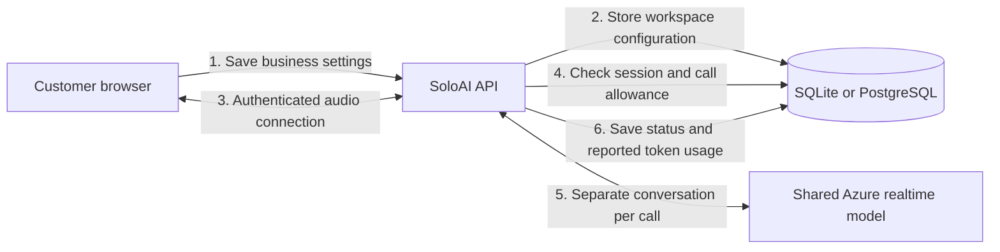

# Voice Receptionist

Voice Receptionist is a browser-call preview. Customers configure it in SoloAI; the operator connects one shared Azure realtime deployment. Each call loads only the signed-in workspace's settings and opens its own Azure conversation. LiveKit is not required for this version.



## Set up your receptionist

1. Open **My agents → Voice Receptionist · Preview** or select it in the Agent store.
2. Enter your business name, approved information, instructions and welcome message. Use `{Company}` in the greeting or instructions.
3. Explain how callers can contact a person when the receptionist cannot help.
4. Choose the model and voice. Only the deployment configured by the operator appears.
5. Save, then select **Start test call** and allow microphone access. End the call when you finish.
6. Reopen the page after a completed test and enable the setup when you are happy with it.

Enabling marks the tested configuration ready. It does not publish a phone service. Signed-in owners can run test calls while the setup is disabled. Editing settings clears the tested and enabled state. Calls already running retain their original instructions; disabling stops them.

Advanced settings contain language, maximum test length and whether callers can interrupt a reply. We do not ask customers for model keys, dispatch rules or infrastructure settings.

## What works today

The receptionist can greet callers, answer from supplied business information and explain how to contact the team. It has no tools for transfers, bookings, orders, payments or saving messages. The server explicitly tells it not to claim those actions. These instructions reduce misleading responses, but do not guarantee that every spoken answer is correct. Test your business scenarios before relying on the answers.

## Operator setup

Use an Azure realtime deployment. Keep the existing chat/email deployment separate. Set these environment variables on the SoloAI server, using a private file outside Git or your secret manager:

```bash
export SOLOAI_VOICE_AZURE_ENDPOINT=https://your-resource.cognitiveservices.azure.com
export SOLOAI_VOICE_AZURE_DEPLOYMENT=gpt-realtime-2.1-mini
# Load SOLOAI_VOICE_AZURE_API_KEY from your private environment file.
export SOLOAI_VOICE_DAILY_SECONDS=600
```

The endpoint is the resource root, without `/openai/v1/realtime` or a query string. The deployment name must match your Azure deployment. Restart SoloAI after changing environment variables. Never put the key in a browser form or commit it.

For local development, `SOLOAI_INIT_SCHEMA=true` creates the voice tables at startup. Existing installations with automatic schema creation disabled must run the application's `init_db()` using their normal deployment environment before enabling this feature. Back up the database first. The voice preview supports SQLite locally and PostgreSQL. It does not support SQL Server yet.

Set `PUBLIC_ORIGIN` to the exact browser origin, including the local port. Production needs HTTPS and a proxy that supports WebSocket upgrades and connections lasting at least the configured call duration. Browsers require a secure context for microphone access; localhost is permitted for local tests.

## Request flow



Audio passes through SoloAI to Azure. The browser receives audio, not the Azure key. The server supplies instructions and accepts audio bytes only, so a caller cannot submit arbitrary session settings or tools through this endpoint. There are no database tools attached to the model.

## Limits and privacy

- One active call per workspace, with a maximum length of three minutes.
- Ten minutes reserved per workspace per UTC day by default. The full selected duration counts when a call starts, including failed or short calls.
- The server checks session expiry, logout and stop controls during a call.
- Configuration changes use revision checks to prevent overwriting newer settings.
- SoloAI stores settings and operational call metadata, including reported token totals. It does not persist call audio or transcripts. Azure processes the audio under your Azure service terms.
- Voice has its own duration allowance. It is not deducted from the existing email/chat token budget. The allowance limits usage, but is not a currency spending cap.

This is a pilot, not a production telephone service. The audio relay adds a server hop and holds a connection per call. Before a wider rollout, measure concurrent calls, reconnect behavior, audio quality, provider throttling and regional latency. LiveKit or a direct WebRTC design can be evaluated when those requirements are known.

## Troubleshooting

| Problem | Check |
|---|---|
| Voice is not connected | Confirm all three Azure variables are present on the running server. Restart after changes. |
| Browser says Could not connect; server logs Unsupported upgrade request | Reinstall `requirements.txt` and restart SoloAI. Browser calls require the pinned `wsproto` dependency. In-process API tests do not verify the network upgrade. |
| Call fails immediately | Check the deployment name, Azure access and exact `PUBLIC_ORIGIN`. Never paste keys into logs. |
| Microphone blocked | Allow microphone access for SoloAI in browser settings. Use localhost or HTTPS. |
| No Enable button after testing | End the call and reopen the voice page. A completed model response is required for the saved revision. |
| Workspace already has a call | End the other call. A stale reservation expires after its maximum duration plus fifteen seconds. |
| Daily allowance reached | Wait until the next UTC day or ask the operator to review the allowance. |

## Verification

Automated tests cover workspace isolation, configuration revisions, model selection, enabling checks, origin checks, concurrent-call reservations and daily limits. A live smoke test against the configured Azure deployment returned audio through the SoloAI endpoint. Physical microphone quality and telephone handling are separate checks; telephone handling is not implemented.

API reference: [Azure realtime audio over WebSockets](https://learn.microsoft.com/en-us/azure/foundry/openai/how-to/realtime-audio-websockets).
