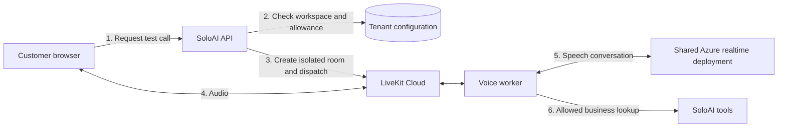

# Voice Receptionist

Voice Receptionist is being developed on `feature/livekit-voice-receptionist`. It is not available in the agent store yet. This guide describes the first release and the services the SoloAI operator needs to provision.

## First release

A customer will choose Voice Receptionist in the agent store, enter their business details and test a conversation in their browser. SoloAI will manage the shared voice infrastructure. Customers will not need Azure or LiveKit credentials.

The setup form will ask for:

- Business name and a short description.
- Greeting, language and time zone.
- Opening hours and approved answers to common questions.
- How staff should follow up when the agent cannot help.
- Call duration and usage limits within the workspace allowance.

The first version will answer approved questions and collect requests for staff to review. It will not place orders, change bookings or take payments. Telephone numbers and live call transfer require a separate telephony connection. The browser test must not suggest that a phone number is already connected.

The planned release sequence is **Save setup → Test a call → Enable**. Saving changes should not alter a call already in progress.

## Azure deployment

Create an Azure OpenAI deployment of `gpt-realtime-mini`, using a GA version offered by your subscription. Use the deployment name `soloai-voice`. Sweden Central is a supported starting region; check availability and quota before creating the deployment. Region choice alone is not a promise of regional inference residency.

Deploy a realtime model, not a registered Foundry agent or a chat-completions deployment. Keep the existing `gpt-4.1-mini` deployment for chat and email.

The operator supplies the Azure resource endpoint, deployment name and a server-side credential. LiveKit's current Azure realtime integration uses the GA API. Do not copy the preview API version from the email connection into the voice settings.

References: [Azure realtime support](https://learn.microsoft.com/en-us/azure/foundry/openai/how-to/realtime-audio-sip), [LiveKit Azure adapter](https://docs.livekit.io/agents/models/realtime/azure-openai/).

## LiveKit

Start with one LiveKit Cloud project for SoloAI. Its Build plan is listed at $0 per month with limited allowances. Azure inference is billed separately when using our own Azure deployment. Telephone availability and allowances depend on the plan and country.

The LiveKit Agents framework is open source. Self-hosting still requires servers, networking and someone to operate them. We will use Cloud for the pilot to keep the initial operational work small. Check the [current pricing](https://livekit.com/pricing) before enabling paid usage.

The operator needs the LiveKit project URL, API key and API secret. These stay on the server. A customer receives only a short-lived token for their own call room.

## Proposed call flow

Each call needs a separate room, conversation and server-derived workspace identity. Room metadata and caller speech must not grant access to a workspace. The worker must load configuration from SoloAI and reject calls it cannot authenticate.

Before launch we need tests for cross-workspace access, expired tokens, concurrent calls, interruptions, model errors, worker disconnects and usage limits. The existing email tests do not cover these voice behaviors.

## Current status

The branch and deployment plan are prepared. Azure voice credentials and a LiveKit project are still needed for live testing. No voice worker, phone number or cloud infrastructure has been deployed by this change.
