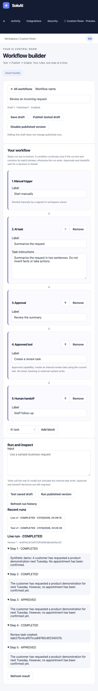
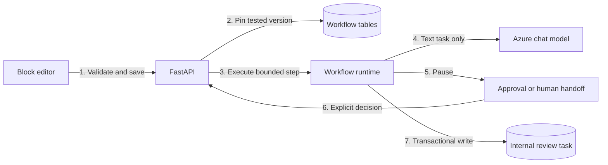

# Custom flows preview

SoloAI now has a small native workflow builder. Open **Custom flows · Preview**, create a template and edit its blocks. This is a block editor, not yet a chat interface that generates workflows from a description.

## What you can build

| Block | Current behavior |
|---|---|
| Trigger | A signed-in workspace owner starts the run manually. |
| AI task | Your configured Azure chat model transforms the current text using your instructions. |
| Approved tool | Creates an internal SoloAI review task. Tests simulate this write. |
| Condition | Continues if the current text contains the specified phrase, ignoring case. Otherwise stops without running later steps. |
| Approval | Waits for an explicit approve or reject decision in SoloAI. |
| Human handoff | Pauses for staff to review the result and mark the handoff complete or reject it. No external notification is sent. |

The diagram runs top to bottom. Add blocks, edit their labels and move them up to change the order. There are no loops, parallel branches, arbitrary code, SQL, external URLs or model-selected tools. Conditions are simple text checks, not security controls. Only AI tasks replace the text passed to later blocks.

## Test, publish and enable

1. Save a draft. Each save creates a new draft revision.
2. Enter synthetic input and select **Test saved draft**. AI calls use the real Azure connection and workspace token allowance. Internal task writes are simulated.
3. Inspect the step outputs. Approve or reject at approval steps, and complete any handoffs.
4. A completed test makes that exact draft revision eligible for publication. A single successful test is not a production certification.
5. Publish. This stores an immutable definition and leaves the workflow disabled until you explicitly enable it.
6. Enable, then use **Run published version** to create real internal review tasks.

Editing a draft does not change an enabled published definition or an existing run. Publishing a new version disables the workflow until you enable it again. Disabling blocks continuation of live runs, including writes after an AI response returns. The existing Stop all agents control also invalidates active runs through the workspace stop epoch.

## State and recovery

Definitions, published versions, runs, steps and internal tasks are persisted in PostgreSQL, or SQLite for local development. A run pins its definition when it starts. Approval and handoff decisions survive API restarts.

Execution currently happens in the API request, not a background scheduler. If a request is interrupted between steps, open its run history and choose **Resume / check interrupted run**. This continues from the persisted step boundary. There is no automatic recovery worker in this preview.

An AI step is marked RUNNING before the external request. After a crash, its sixty-second claim eventually becomes eligible to be marked UNKNOWN/FAILED on resume. SoloAI does not replay it because the provider outcome and token charge may be uncertain. Failed or timed-out AI requests retain their reserved token allowance. Start a new run only after reviewing the failure.

Internal task creation and step completion happen in one transaction. A unique run-and-step constraint prevents duplicate tasks. Each start request carries an idempotency key: retrying the same request returns its existing run; reusing that key with different input is rejected. Clicking Run again is a new intentional run, not a retry. Approval decisions can be submitted only while the run is waiting.

## Setup and limits

No new Azure service or dependency is required. AI tasks use the existing direct Azure chat connection: `AZURE_OPENAI_ENDPOINT`, `AZURE_OPENAI_DEPLOYMENT`, `AZURE_OPENAI_API_KEY` and the configured API version. The realtime voice model is not used. Foundry Agent Service-only installations need a direct chat deployment for this preview.

New tables are added through `init_db()`. For local runs, `SOLOAI_INIT_SCHEMA=true` handles this on startup. Existing installations that disable schema initialization must run their normal controlled `init_db()` deployment step before exposing the builder. SQL Server is not supported by this preview.

Limits are twelve blocks, three AI tasks per run, twenty workflows per workspace and one hundred starts per rolling twenty-four hours. Each model request has a timeout and output cap. AI usage is reserved against the workspace budget before a call.

Run inputs, outputs and internal tasks are stored without automatic expiry in this preview. Use synthetic data. Production rollout requires a retention/deletion process, background recovery, operational monitoring, load tests, and review of role-based approvals. Currently any signed-in owner of the workspace can approve its runs; there is no independent second-reviewer role.

Email events, schedules, webhook triggers, external writes, generic MCP tools, conversational workflow generation and arbitrary branching are not connected. These controls must be implemented and tested before they can appear as supported capabilities.

## Architecture

